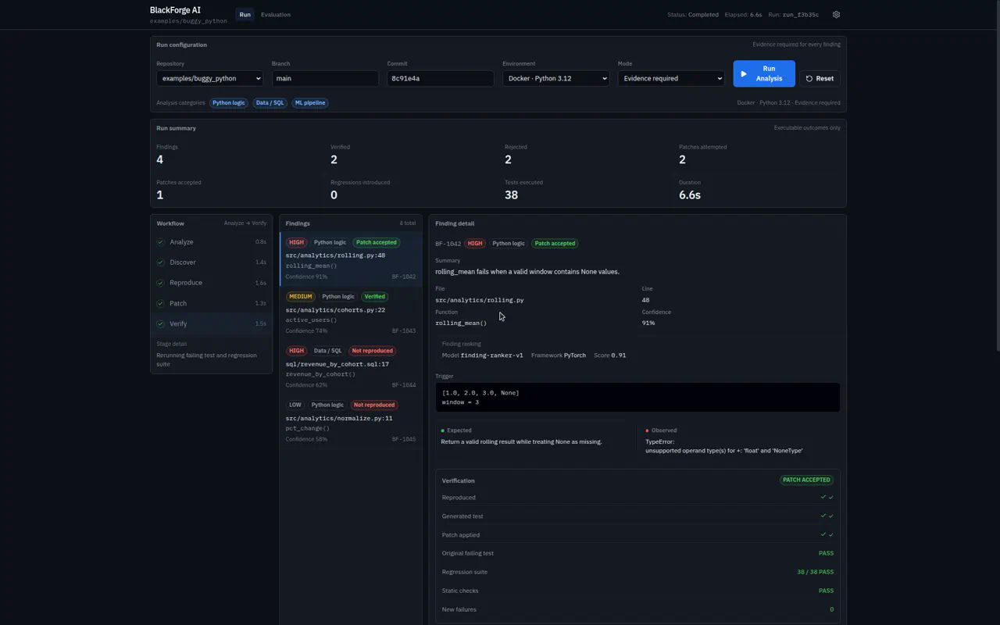

# BlackForge AI

**Break it. Fix it. Prove it.**

BlackForge AI is meant to be an autonomous reliability system for data and ML workflows — not another LLM chat wrapper.

The idea is simple: find likely bugs, reproduce them with executable evidence, generate a minimal patch, then accept or reject that patch only after the original failure and the regression suite both pass.

> AI findings are not trusted until they are backed by executable evidence.

## Demo

Early analysis-console walkthrough (UI prototype — work in progress):



<video src="docs/demo/analysis-console.mp4" controls width="100%"></video>

Demo recording: [`docs/demo/analysis-console.mp4`](docs/demo/analysis-console.mp4)

## What this project is supposed to be

BlackForge is aimed at silent failures in analytics and ML systems — wrong joins, bad null handling, train/test leakage, broken metrics — the kind of bugs that do not always crash a program but still corrupt decisions.

The intended loop:

1. **Analyze** a target repository
2. **Discover** a concrete failure case (with a real failing test)
3. **Reproduce** that failure in an isolated environment
4. **Patch** with the smallest reasonable fix
5. **Verify** by rerunning the failing case plus regressions

Only then should a repair count as accepted.

Internally that may be implemented with specialized agents (discovery, patching, refereeing). Externally it should feel like a serious engineering tool: findings, evidence, diffs, and verification results — not agent role-play.

## Current status

This repository is **early and incomplete**.

What exists so far:

- A production-styled **analysis console** prototype (`code/blackforge`) that simulates the full Analyze → Discover → Reproduce → Patch → Verify workflow with mock data
- A small **deterministic core** (`src/blackforge`) with schemas, pytest/Docker runners, SQLite storage, a patch utility, and a Referee path that can reproduce a known failing test
- One intentionally buggy example (`examples/buggy_python`)

What is still ahead:

- Connecting the UI to a real FastAPI backend
- Actual discovery and patch-generation agents
- Stricter Docker-based verification
- Broader data/SQL/ML examples and evaluation metrics

## Philosophy

BlackForge should optimize for credibility over spectacle:

- Evidence over opinion
- Reproduction before repair
- Regression safety before “patch accepted”
- Measurable outcomes (reproduction rate, false positives, patch success)

## Layout

```text
code/blackforge/     # Analysis console (frontend prototype)
src/blackforge/      # Deterministic Python core (early)
examples/            # Intentionally buggy target repos
docs/demo/           # Demo recording + screenshot
tests/               # Core tests
```

## Quick start (as of now)

Frontend prototype:

```bash
cd code/blackforge
npm install
npm run dev
```

Deterministic reproduce path:

```bash
uv sync --extra dev
uv run blackforge reproduce \
  --repo examples/buggy_python \
  --test tests/test_rolling_mean_none.py \
  --local
```

---

Built as a portfolio-oriented AI engineering project for reliability in data and ML systems.
