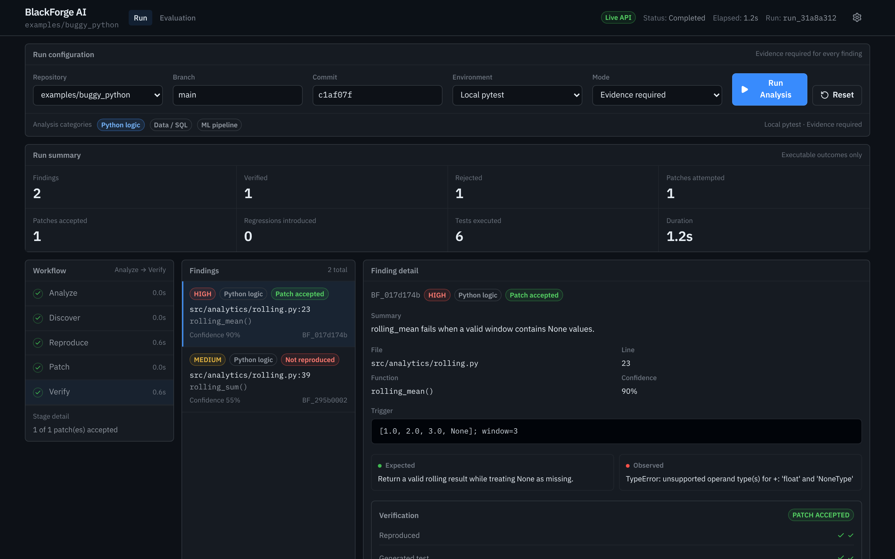
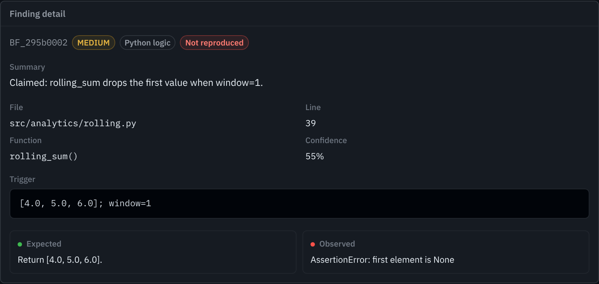
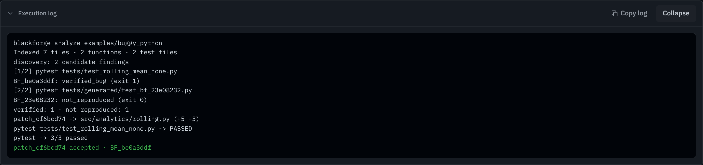

# BlackForge AI

**Break it. Fix it. Prove it.**

BlackForge AI is meant to be an autonomous reliability system for data and ML workflows — not another LLM chat wrapper.

The idea is simple: find likely bugs, reproduce them with executable evidence, generate a minimal patch, then accept or reject that patch only after the original failure and the regression suite both pass.

> AI findings are not trusted until they are backed by executable evidence.

## Demo

A real run against the live backend on `examples/buggy_python`: two candidate findings, one reproduced and patched, one rejected because its test passed.



| A false claim, rejected by the Referee | The run's log, streamed live over SSE |
| --- | --- |
|  |  |

Earlier walkthrough of the console on mock data: [`docs/demo/analysis-console.mp4`](docs/demo/analysis-console.mp4).

## What this project is supposed to be

BlackForge is aimed at silent failures in analytics and ML systems — wrong joins, bad null handling, train/test leakage, broken metrics — the kind of bugs that do not always crash a program but still corrupt decisions.

The intended loop:

1. **Analyze** a target repository
2. **Discover** a concrete failure case (with a real failing test)
3. **Reproduce** that failure in an isolated environment
4. **Patch** with the smallest reasonable fix
5. **Verify** by rerunning the failing case plus regressions

Only then should a repair count as accepted.

Internally that may be implemented with specialized agents (discovery, patching, refereeing). Externally it should feel like a serious engineering tool: findings, evidence, diffs, and verification results — not agent role-play.

## Current status

The deterministic loop works end to end and the console shows it live. The AI parts that will propose findings and patches are not built yet.

What exists so far:

- An **analysis console** (`frontend/`) for the Analyze → Discover → Reproduce → Patch → Verify workflow. It runs against the live API when `blackforge serve` is up and falls back to simulated mock data when it is not (the header shows **Live API** or **Mock data**)
- A **FastAPI backend** (`src/blackforge/api`) that starts runs in the background, streams their progress as Server-Sent Events, and serves findings, evidence, patches and metrics from SQLite
- A **deterministic core** (`src/blackforge`) with schemas, pytest/Docker runners, SQLite storage, a patch utility, a Referee that reproduces findings, and a Verifier that accepts a patch only if the failing test now passes and the full suite stays green, on an isolated copy of the repo
- One intentionally buggy example (`examples/buggy_python`) with a seeded manifest (`blackforge.json`): one real bug with a reference patch, and one false claim the Referee should reject

What is still ahead:

- Actual discovery and patch-generation agents (today candidates and patches come from the seeded manifest; every verdict already comes from running tests)
- Stricter Docker-based verification
- Broader data/SQL/ML examples and evaluation metrics

## How a run works

```text
console (React)                FastAPI (blackforge serve)              core
───────────────                ──────────────────────────              ────
POST /api/runs  ─────────────▶ RunManager: thread pool ─────────────▶ Pipeline.execute
EventSource /events ◀── SSE ── polls run_events table ◀── appends ─── each stage + log line
GET /api/runs/{id} ◀────────── run + findings + verdicts from SQLite
```

1. **Analyze.** The target is copied to `.blackforge/workspaces/<run>/repo`, so a run never writes into the original checkout, then indexed (files, functions, tests).
2. **Discover.** Candidate findings are read from the target's `blackforge.json`. This is the seam where the LLM discovery agent will plug in.
3. **Reproduce.** The Referee runs each finding's test. Exit code 1 with matching evidence is `verified_bug`; a passing test is `not_reproduced`; a broken test is `invalid_test`.
4. **Patch.** Each verified finding gets a `PatchAttempt` (today the manifest's reference patch; later the patch agent).
5. **Verify.** On a fresh copy, the Verifier applies the diff, compiles touched files, reruns the attack test and the full suite, and accepts the patch only if all pass.

Every step appends to an event log in SQLite. The console's live view, the run detail and the metrics all read from that one store.

## Philosophy

BlackForge should optimize for credibility over spectacle:

- Evidence over opinion
- Reproduction before repair
- Regression safety before “patch accepted”
- Measurable outcomes (reproduction rate, false positives, patch success)

## Layout

```text
frontend/                  # Analysis console (React + Vite); live API with mock fallback
src/blackforge/
  api/                     # FastAPI app, routes, SSE stream, background runs
  agents/referee.py        # Decides whether a finding reproduces
  verify/verifier.py       # Decides whether a patch is accepted
  pipeline.py              # Analyze → Discover → Reproduce → Patch → Verify
  core/                    # Schemas, settings, SQLite storage, target manifests
  execution/               # pytest/Docker runners, patch applier, workspaces
examples/                  # Intentionally buggy target repos (+ blackforge.json)
docs/demo/                 # Screenshots and recording
tests/                     # Unit, integration and API tests
```

## Quick start (as of now)

Backend API (port 8000):

```bash
uv sync --extra dev
uv run blackforge serve
```

Console (port 4827, proxies `/api` to the backend):

```bash
cd frontend
npm install
npm run dev
```

Open http://localhost:4827 and click **Run Analysis**. Without the backend running, the console replays mock data instead. Interactive API docs are at http://localhost:8000/docs.

### API

| Endpoint | Purpose |
| --- | --- |
| `GET /api/health` | Version and whether Docker is available |
| `GET /api/repos` | Target repos (folders under `examples/` with a `blackforge.json`) |
| `POST /api/runs` | Start a run: `{"repo_id", "mode", "categories"}` → `202` with the run id |
| `GET /api/runs` · `GET /api/runs/{id}` | Run list · one run with stages, findings, verdicts, patches and summary |
| `GET /api/runs/{id}/events` | Server-Sent Events: stage progress and log lines (resumes with `Last-Event-ID`) |
| `POST /api/runs/{id}/cancel` | Stop a running run |
| `GET /api/findings/{id}` | One finding with its Referee history, patch and verification result |
| `POST /api/findings/{id}/verify` | Re-run the Referee on a stored finding |
| `GET /api/metrics?repo=` | Reproduction rate, patch success, regression rate, computed from stored runs |

Tests:

```bash
uv run --extra dev pytest
```

Deterministic reproduce path (from this folder):

```bash
uv sync --extra dev
uv run blackforge reproduce \
  --repo examples/buggy_python \
  --test tests/test_rolling_mean_none.py \
  --local
```

---
